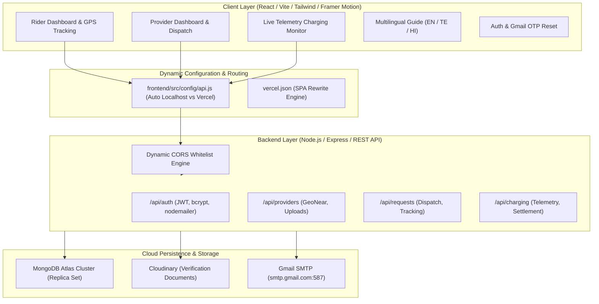
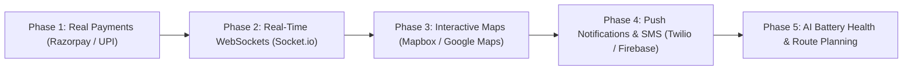

# VOLNXT — Complete System Architecture, Implementation Guide & Next Steps Roadmap

> **Author**: Google DeepMind / Antigravity Assistant  
> **Brand**: VOLNXT (Next-Generation Mobile On-Demand EV Charging Network)  
> **Repository**: [https://github.com/AdepuSanjay/Volnxt.git](https://github.com/AdepuSanjay/Volnxt.git)  
> **Deployed Frontend**: [https://volnxt-nbof.vercel.app](https://volnxt-nbof.vercel.app)  
> **Target Platforms**: Mobile Web (PWA-ready), Tablet, Desktop  

---

## Table of Contents
1. [Executive Overview & Vision](#1-executive-overview--vision)
2. [End-to-End System Architecture](#2-end-to-end-system-architecture)
3. [Tech Stack & Dependencies](#3-tech-stack--dependencies)
4. [Database Models & Schemas](#4-database-models--schemas)
5. [Complete API Reference & Endpoints](#5-complete-api-reference--endpoints)
6. [Core Workflows Implemented (Up to Now)](#6-core-workflows-implemented-up-to-now)
   - 6.1 [Authentication & Gmail OTP Password Reset](#61-authentication--gmail-otp-password-reset)
   - 6.2 [Multi-Step Rider & Provider Registration](#62-multi-step-rider--provider-registration)
   - 6.3 [Smart Proximity Dispatch & Matching](#63-smart-proximity-dispatch--matching)
   - 6.4 [Live Biker Coming Approach Tracking](#64-live-biker-coming-approach-tracking)
   - 6.5 [Live High-Current Charging Telemetry Engine](#65-live-high-current-charging-telemetry-engine)
   - 6.6 [Multilingual System (English, Telugu, Hindi)](#66-multilingual-system-english-telugu-hindi)
   - 6.7 [Mobile-First UI & Responsive Engineering](#67-mobile-first-ui--responsive-engineering)
7. [Deployment & Environment Configuration](#7-deployment--environment-configuration)
8. [What Next: Prioritized Future Features Roadmap](#8-what-next-prioritized-future-features-roadmap)
9. [Developer Guide & Local Setup](#9-developer-guide--local-setup)

---

## 1. Executive Overview & Vision

**VOLNXT** is an on-demand, mobile-first electric vehicle (EV) charging platform designed to eliminate EV range anxiety in India and emerging markets. It bridges two primary user groups:
1. **EV Riders**: EV owners driving cars, bikes, or commercial fleets who run low on battery and need certified high-speed mobile DC charging dispatched directly to their GPS coordinates, or need to locate community home wallbox stations nearby.
2. **Charging Host Providers**: Homeowners with 15A/7.4kW wallboxes, commercial parking garages, and mobile charging van/bike operators who want to monetize their idle electrical infrastructure and earn passive income.

---

## 2. End-to-End System Architecture



---

## 3. Tech Stack & Dependencies

### Frontend (`/frontend`)
- **Framework**: React 18.2 + Vite 5.4 (lightning-fast ESModule builds)
- **Styling**: Tailwind CSS 3.4 (custom gradients, dark mode accents, mobile touch targets)
- **Animations**: `framer-motion` 14.0 (smooth layout transitions, expanding cards, radar pulses)
- **Icons**: `lucide-react` (high-contrast, responsive SVG icons)
- **HTTP Client**: `axios` 1.6 (with dynamic base URL and bearer token interceptors)
- **Router**: `react-router-dom` 6.20 (SPA client routing with protected routes)

### Backend (`/backend`)
- **Runtime**: Node.js + Express 5.2
- **Database**: MongoDB Atlas via `mongoose` 9.11
- **Security**: `helmet`, `cors` (permissive origin matcher), `bcrypt` (password salting)
- **Token Auth**: `jsonwebtoken` (JWT bearer tokens with 30-day expiration)
- **Email/OTP**: `nodemailer` with Google SMTP (TLS port 587)
- **File Uploads**: `multer` + `multer-storage-cloudinary`

---

## 4. Database Models & Schemas

### 4.1 User Schema (`backend/models/User.js`)
| Field | Type | Description |
| :--- | :--- | :--- |
| `name` | String | Full user name or business entity name |
| `email` | String | Unique email address (indexed, lowercase) |
| `phone` | String | Mobile number for SMS & call dispatch |
| `password` | String | Salted & hashed password via bcrypt |
| `role` | String | Enum: `'RIDER'`, `'PROVIDER'`, `'ADMIN'` |
| `aadharNumber` | String | Indian identity verification record |
| `profilePhoto` | String | Cloudinary image URL |
| `resetPasswordOtp` | String | 6-digit verification code for password reset |
| `resetPasswordExpires` | Date | OTP expiration timestamp (10-minute window) |

### 4.2 Vehicle Schema (`backend/models/Vehicle.js`)
Linked to Rider User ID:
- `vehicleType`: Car, Two-Wheeler, Commercial Van
- `brand` & `vehicleModel`: e.g. Tata Nexon EV, MG ZS EV, Ather 450X
- `batteryCapacity`: Battery pack size in kWh (e.g. 30.2 kWh, 40.5 kWh)
- `currentBatteryPercentage`: Current State of Charge (SoC %)
- `connectorType`: CCS2, Type 2, CHAdeMO, 15A Socket
- `maxChargingPower`: Max acceptance rate in kW (e.g. 50 kW)

### 4.3 Provider Profile Schema (`backend/models/ProviderProfile.js`)
- `providerType`: `'INDIVIDUAL'` (home wallbox) or `'BUSINESS'` (commercial station/mobile van)
- `latitude` & `longitude`: Exact decimal GPS coordinates for geospatial proximity
- `chargingType` & `connectorType`: Available physical sockets
- `pricingModel`: `'PER_KWH'`, `'PER_PERCENTAGE'`, or `'FIXED'`
- `price`: Unit tariff (e.g. ₹15 / kWh)
- `availability`: `'AVAILABLE'`, `'BUSY'`, `'OFFLINE'`
- `isOnline`: Instant dispatch visibility toggle

### 4.4 Charging Request Schema (`backend/models/ChargingRequest.js`)
- `riderId` & `providerId`: References to User
- `batteryStart` & `targetBattery`: e.g. 15% to 80%
- `estimatedPrice` & `estimatedTime`: Calculated upfront rate & minutes
- `status`: `'PENDING'`, `'ACCEPTED'`, `'ON_THE_WAY'`, `'ARRIVED'`, `'CHARGING'`, `'COMPLETED'`, `'CANCELLED'`
- **Real-time Biker Fields**:
  - `bikerName`: Assigned certified technician name
  - `bikerPhone`: Contact phone for live calling
  - `bikerVehicle`: Mobile DC Van registration and specs
  - `currentDistanceKm`: Real-time proximity distance (ticks down)
  - `etaMinutes`: Dynamic minutes countdown
  - `currentLat` & `currentLng`: Moving GPS coordinates
  - `riderLat` & `riderLng`: Destination vehicle pin

### 4.5 Charging Session Schema (`backend/models/ChargingSession.js`)
- `requestId`: Reference to origin ChargingRequest
- `startBatteryPercentage`, `targetBatteryPercentage`, `currentBatteryPercentage`, `endBatteryPercentage`
- `chargingPowerKw`: Live power delivery (e.g. 29.5 kW)
- `voltageV`: High-voltage reading (e.g. 382 V)
- `currentA`: DC amperage (e.g. 77.2 A)
- `energyDeliveredKwh`: Accumulated energy units
- `platformFee` & `providerAmount`: 10% network commission split
- `status`: `'CHARGING'`, `'IN_PROGRESS'`, `'COMPLETED'`
- `batteryUpdates`: Time-series array logging every telemetry pulse

---

## 5. Complete API Reference & Endpoints

### Authentication & Password Reset (`/api/auth`)
| Method | Endpoint | Description | Payload / Params |
| :--- | :--- | :--- | :--- |
| `POST` | `/api/auth/register` | Register Rider or Provider | `{ name, email, phone, password, role, vehicle, ... }` |
| `POST` | `/api/auth/login` | Authenticate user & get JWT token | `{ email, password }` |
| `GET` | `/api/auth/me` | Fetch active user profile + vehicle/provider data | Header: `Authorization: Bearer <token>` |
| `POST` | `/api/auth/forgot-password` | Dispatches 6-digit OTP via Gmail SMTP | `{ email }` |
| `POST` | `/api/auth/reset-password` | Verifies OTP and applies new bcrypt password | `{ email, otp, newPassword }` |

### Provider Stations & Discovery (`/api/providers`)
| Method | Endpoint | Description | Payload / Params |
| :--- | :--- | :--- | :--- |
| `GET` | `/api/providers/nearby` | Geospatial proximity search (10 - 100 km) | Query: `?lat=...&lng=...&radius=50` |
| `GET` | `/api/providers/profile` | Get logged-in provider station profile | Header: `Bearer <token>` |
| `PUT` | `/api/providers/status` | Toggle station status between Online / Offline | `{ isOnline: true/false }` |
| `POST` | `/api/providers/upload` | Upload government ID/station document | `multipart/form-data` (file: `media`) |

### Requests & Biker Dispatch Tracking (`/api/requests`)
| Method | Endpoint | Description | Payload / Params |
| :--- | :--- | :--- | :--- |
| `POST` | `/api/requests` | Rider creates on-demand request | `{ providerId, batteryStart, targetBattery, distance, riderLat, riderLng }` |
| `GET` | `/api/requests/my` | Rider fetches active and historical requests | Header: `Bearer <token>` |
| `GET` | `/api/requests/provider` | Provider fetches incoming charging requests | Header: `Bearer <token>` |
| `PUT` | `/api/requests/:id/accept` | Provider accepts & dispatches biker | `{ bikerName, bikerVehicle, bikerPhone }` (sets `ON_THE_WAY`) |
| `PUT` | `/api/requests/:id/reject` | Provider declines request | Sets `status: 'REJECTED'` |
| `PUT` | `/api/requests/:id/tracking` | Updates real-time biker distance & ETA | `{ currentDistanceKm, etaMinutes, status }` |
| `PUT` | `/api/requests/:id/status` | Direct lifecycle transition | `{ status: 'ARRIVED' / 'CANCELLED' }` |

### Live Charging Telemetry & Billing (`/api/charging`)
| Method | Endpoint | Description | Payload / Params |
| :--- | :--- | :--- | :--- |
| `POST` | `/api/charging/start` | Starts high-voltage charging session | `{ requestId, startBatteryPercentage, targetBatteryPercentage, priceRate }` |
| `GET` | `/api/charging/active` | Detects any running session for logged-in user | Header: `Bearer <token>` |
| `GET` | `/api/charging/:id` | Polls live telemetry metrics | Header: `Bearer <token>` |
| `PUT` | `/api/charging/:id/update-battery` | Pushes real-time battery & power telemetry | `{ percentage, powerKw, voltage, current, energyKwh }` |
| `PUT` | `/api/charging/:id/end` | Completes session, calculates fee & marks paid | `{ endBatteryPercentage }` |

---

## 6. Core Workflows Implemented (Up to Now)

### 6.1 Authentication & Gmail OTP Password Reset
- Designed with branded split-screen UI (Left: Form; Right: High-impact EV imagery with trust badges).
- Built password recovery flow via Gmail SMTP:
  - Generates cryptographically secure 6-digit numeric OTP with 10-minute validity.
  - Sends branded HTML email with security instructions.
  - Verification step validates OTP and hashes the new password with bcrypt salt.

### 6.2 Multi-Step Rider & Provider Registration
- **Rider (3 Steps)**:
  1. Personal & Identity (Name, Email, Phone, Password, Aadhaar)
  2. EV Vehicle Specifications (Make, Model, Battery kWh, Current SoC %)
  3. Connector & Protocols (CCS2, Type-2, Max acceptance power)
- **Host Provider (3 Steps)**:
  1. Business/Owner Identity & Hosting Type (Individual Homeowner vs Commercial Station)
  2. Station Geolocation with 1-Tap Device GPS Detection (`navigator.geolocation`) + manual coordinate overrides
  3. Hardware Specifications, Tariffs (₹/kWh or Fixed) & Electrical Safety Declaration

### 6.3 Smart Proximity Dispatch & Matching
- Rider Dashboard uses Haversine geospatial proximity algorithm to locate chargers within configurable radiuses: **10 km, 25 km, 50 km, and 100 km**.
- Highlights connector compatibility, live distance, estimated cost, and power output.

### 6.4 Live Biker Coming Approach Tracking
- When a provider accepts, the request moves to `ON_THE_WAY`.
- **Rider Dashboard displays**:
  - Live animated highway route track with moving vehicle icon.
  - Live distance countdown decreasing by 150m-250m every 3 seconds.
  - Live ETA countdown in minutes.
  - Technician contact card with direct click-to-call button.
  - 4-step stepper (`Request Matched` ➔ `Biker Approaching` ➔ `Arrived at Vehicle` ➔ `High-Speed Charge`).
  - Auto-advances to `ARRIVED` when distance hits 0.

### 6.5 Live High-Current Charging Telemetry Engine
- **Telemetry Loop**:
  - Both Rider and Provider screens poll every 2 seconds.
  - Power output fluctuates realistically around 29.5 kW DC Fast.
  - Voltage (382V) and Current (77A) update live.
  - Cumulative energy delivered (+kWh) and live running cost (₹) accumulate.
  - Terminal feed displays live CAN Bus diagnostic events.
  - Either party can stop charging, generating an instant itemized invoice with 5-star rating.

### 6.6 Multilingual System (English, Telugu, Hindi)
- Accessible via the **"How to Use"** modal and the dedicated **`/how-to-use`** page.
- Instant switching between:
  - **English (EN)**
  - **తెలుగు (Telugu - TE)**
  - **हिन्दी (Hindi - HI)**
- Persists user language choice in `localStorage`.
- Translates all headers, subtitles, 5 Rider steps, 5 Provider steps, pro tips, and CTAs.

### 6.7 Mobile-First UI & Responsive Engineering
- Tested for all screen widths (360px phones up to 4K displays).
- Features momentum scrolling (`-webkit-overflow-scrolling: touch`), sticky touch-friendly action bars, safe area margins, and clean touch targets (min 44px).

---

## 7. Deployment & Environment Configuration

### Dynamic Base URL Resolution (`frontend/src/config/api.js`)
The application automatically detects its host environment without needing manual rebuilds:
- **Localhost / 127.0.0.1**: Calls `http://localhost:5000`
- **Deployed on Vercel**: Calls `https://volnxt-nbof.vercel.app` (or custom `VITE_API_URL`)

### Vercel SPA Routing Configuration (`frontend/vercel.json`)
```json
{
  "rewrites": [
    {
      "source": "/(.*)",
      "destination": "/index.html"
    }
  ]
}
```
Prevents 404 errors on page reload for client-side routes like `/login`, `/register`, `/how-to-use`, and `/session/:id`.

### Permissive CORS Configuration (`backend/index.js`)
Accepts requests from `https://volnxt-nbof.vercel.app`, any `*.vercel.app` preview deployments, and local ports (`5173`, `3000`, `5000`).

---

## 8. What Next: Prioritized Future Features Roadmap

Here are the highest-impact features recommended for the next phase of development:



### 1. Real Payment Gateway Integration (Razorpay / UPI / Stripe India)
- **Current State**: Mock payment calculation and settlement.
- **Next Step**: Integrate Razorpay Standard Checkout SDK:
  - Create Order ID on backend (`/api/payments/create-order`).
  - Open UPI / Card / Netbanking modal on frontend.
  - Verify webhook signature on backend (`crypto.createHmac`) before marking payment as `PAID`.
  - Automatic split payout to provider's bank account via Razorpay Route.

### 2. True WebSockets / Socket.io for Zero-Latency Events
- **Current State**: High-efficiency HTTP polling (every 2–2.5 seconds).
- **Next Step**: Replace polling with Socket.io:
  - Rooms partitioned by `requestId` and `sessionId`.
  - Instant dispatch pings (`socket.emit('biker_location_update', { lat, lng })`).
  - Zero server overhead compared to frequent HTTP requests.

### 3. Interactive Map Visualization (Mapbox GL JS or Google Maps SDK)
- **Current State**: SVG / CSS animated route graphic.
- **Next Step**: Embed live interactive Leaflet or Mapbox map:
  - Show real polyline navigation route between biker and rider.
  - Turn-by-turn simulation along real Indian road networks using OSRM or Mapbox Directions API.

### 4. Push Notifications & SMS Dispatch (Firebase Cloud Messaging / Twilio)
- Send SMS and WhatsApp alert to the Rider when the Biker is 500m away.
- Send instant sound push notification to Host Providers when a new request arrives.

### 5. Multi-Biker Fleet Dispatch Engine (For Commercial Operations)
- If a provider operates 5 mobile vans, automatically route the request to the technician with the shortest driving distance and highest available battery buffer.

### 6. Battery Health & Smart Diagnostics (AI Battery Insights)
- Recommend optimal charging limits (e.g. 80% to preserve lithium-ion battery lifespan).
- Estimate charging speed drop-off past 80% due to CC/CV charging curves.

---

## 9. Developer Guide & Local Setup

### Prerequisites
- Node.js 18+ installed
- Git installed
- MongoDB connection string (already configured in code)

### Running Locally

1. **Clone repository**:
   ```bash
   git clone https://github.com/AdepuSanjay/Volnxt.git
   cd capsulate
   ```

2. **Start Backend**:
   ```bash
   cd backend
   npm install
   node index.js
   # Output: Server running on port 5000, MongoDB Connected
   ```

3. **Start Frontend**:
   ```bash
   cd ../frontend
   npm install
   npm run dev
   # Access at: http://localhost:5173
   ```

4. **Production Build**:
   ```bash
   cd frontend
   npm run build
   # Generates optimized dist/ assets ready for Vercel/Netlify
   ```

---

*Document generated and committed to the repository for developer reference.*
